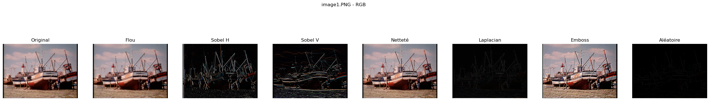

# Image Convolution from Scratch


A hand-written 2D convolution in NumPy, applied to grayscale and RGB images to show how classic kernels behave. No convolution library is used: padding and the sliding window are implemented directly.



## Filters

Blur, horizontal and vertical Sobel, sharpen, Laplacian, emboss and a random kernel.

## Getting started

```bash
pip install -r requirements.txt
jupyter notebook image_convolution.ipynb
```

The notebook expects its input images in a `Photo_RGB/` folder.

## Author

**Yassine Houari** · [LinkedIn](https://www.linkedin.com/in/yassine-houari-/)
